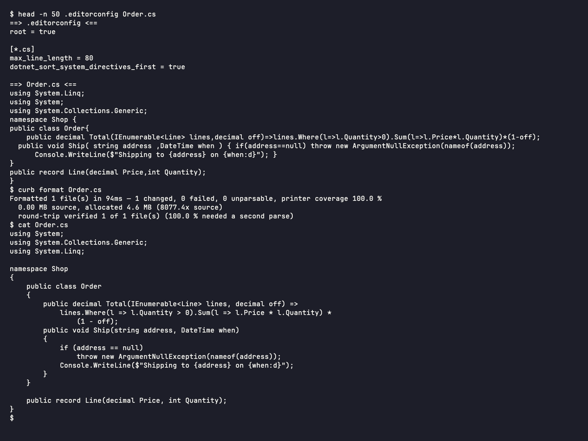

<p align="center">
  <picture>
    <source media="(prefers-color-scheme: dark)" srcset="docs/images/curb-lockup.svg">
    
  </picture>
</p>

<p align="center">A C# formatter that reads your <code>.editorconfig</code>, all of it, and reflows code to a line width the way Prettier does.</p>

<p align="center">
  <a href="https://www.nuget.org/packages/curb"></a>
  <a href="https://github.com/nullean/curb/actions/workflows/ci.yml"></a>
  <a href="https://curb.nullean.net"></a>
</p>



Curb honours the **complete set of .NET formatting options** (code style rule
[IDE0055](https://learn.microsoft.com/dotnet/fundamentals/code-analysis/style-rules/ide0055)). Its defaults are
Roslyn's defaults, so it agrees with Visual Studio and Rider out of the box; `max_line_length` opts into reflow on top.

## Install

### MSBuild: runs on every `dotnet build`

```sh
dotnet add package curb
```

or, by hand:

```xml
<PackageReference Include="curb" Version="*" PrivateAssets="all" />
```

Curb runs before `CoreCompile`, rewriting source in `Debug` and checking in `Release`. With `EnforceCodeStyleInBuild`
set, the only style diagnostics left are the ones that genuinely require a compilation: everything mechanical is
already fixed before the compiler reads the file.

This is the recommended integration for most projects. It is particularly effective in agentic workflows: any code an
agent writes or edits is formatted automatically on the next build, without the agent having to think about it. See
[the build integration docs](https://curb.nullean.net/workflow/msbuild/).

### CLI: pre-commit hooks, CI, scripting

```sh
dotnet tool install -g curb-cli
```

Ships as a native-AOT binary per platform (`linux-x64`, `linux-arm64`, `win-x64`, `win-arm64`, `osx-arm64`), with a
portable fallback. About 10 ms startup.

## Quick start

```sh
curb format ./src          # format in place
curb check ./src           # exit 1 if anything would change
curb print-config Foo.cs   # show every resolved option and its source
```

For code style rules that need a compilation (unused usings, `var`, naming), run a build first and let Curb read what
it reported:

```sh
dotnet build && curb cleanup
```

`curb rules` lists what Curb fixes and what it leaves to `dotnet format style`.

## Why

**Fast enough to run on every build.** Curb is a native-AOT binary with no warm-up cost. Measured cold on
Newtonsoft.Json (945 files):

| | curb | dnf whitespace | CSharpier |
|---|---|---|---|
| Newtonsoft.Json (945 files) | **0.26 s** | 3.47 s | 4.85 s |

`dnf whitespace` is `dotnet format whitespace`, the whitespace-only pass and Curb's closest equivalent. Across twelve
real repositories Curb is 5–25× faster than `dotnet format whitespace`, while doing more: it reflows long lines, sorts
using directives, and applies syntax-level code style on top. Fast enough to wire into `dotnet build` and forget about
it. Full numbers: [Benchmarks](https://curb.nullean.net/benchmarks/).

On subsequent builds the MSBuild integration skips unchanged projects entirely: no process starts. For projects with
changes, only the files that changed since the last build are reformatted. Curb is fast cold, faster warm.

**Plays well with your IDE and `dotnet format`.** Curb supports the full set of `.editorconfig` formatting properties
that Visual Studio, Rider and `dotnet format` read: all 39 `csharp_*` and `dotnet_*` keys of
[IDE0055](https://learn.microsoft.com/dotnet/fundamentals/code-analysis/style-rules/ide0055), plus the ReSharper
wrapping and blank-line keys. Running `dotnet format whitespace` over Curb's output never disagrees: measured across
41,000 files, gated on every push.

### F#, through Fantomas

Declare Fantomas in your tool manifest (`dotnet tool install fantomas`) and `curb format` and `curb check` cover your
`.fs`, `.fsi` and `.fsx` files too, through that exact version, with Curb's cache, MSBuild target and safety check on
top: a result is written only if Fantomas leaves it unchanged when it is sent back. Without the manifest entry nothing
changes. See [F# through Fantomas](https://curb.nullean.net/workflow/fsharp/).

### Razor (experimental)

Opt in from a section that names Razor files, and `curb format` and `curb check` format the C# in the `@code`,
`@functions` and `@{ }` blocks of `.razor` and `.cshtml` files with your C# options. A second key re-indents the
markup by its nesting, as Microsoft's Razor formatter does, and places continued attributes by
`razor_attribute_indent_style`:

```ini
[*.{razor,cshtml}]
curb_razor_format_code_blocks = true
curb_razor_format_markup = true
```

Markup changes only in its indentation. Directives and expressions stay exactly as written, and the MSBuild package
never formats Razor files. See [Razor](https://curb.nullean.net/workflow/razor/).

## Packages

| Package | What it is | |
|---|---|---|
| [`curb`](src/Nullean.Curb.MSBuild/README.md) | MSBuild integration: formats before `CoreCompile` on every build | [](https://www.nuget.org/packages/curb) |
| [`curb-cli`](src/Nullean.Curb.Cli/README.md) | the `curb` .NET tool: `format`, `check`, `print-config`, `cleanup`, `rules` | [](https://www.nuget.org/packages/curb-cli) |

## Learn more

- Documentation: https://curb.nullean.net, with the full option reference, design rationale and the build integration
  guide
- [Known limitations](docs/known-limitations.md)
- Building from source: `git clone git@github.com:nullean/curb.git`, then `mise run build` and `mise run test`
  ([mise](https://mise.jdx.dev) installs the .NET SDK `global.json` names)
- [Releases](https://github.com/nullean/curb/releases)
- [Contributing](https://github.com/nullean/.github/blob/main/CONTRIBUTING.md)

MIT licensed. Copyright Nullean and contributors.
