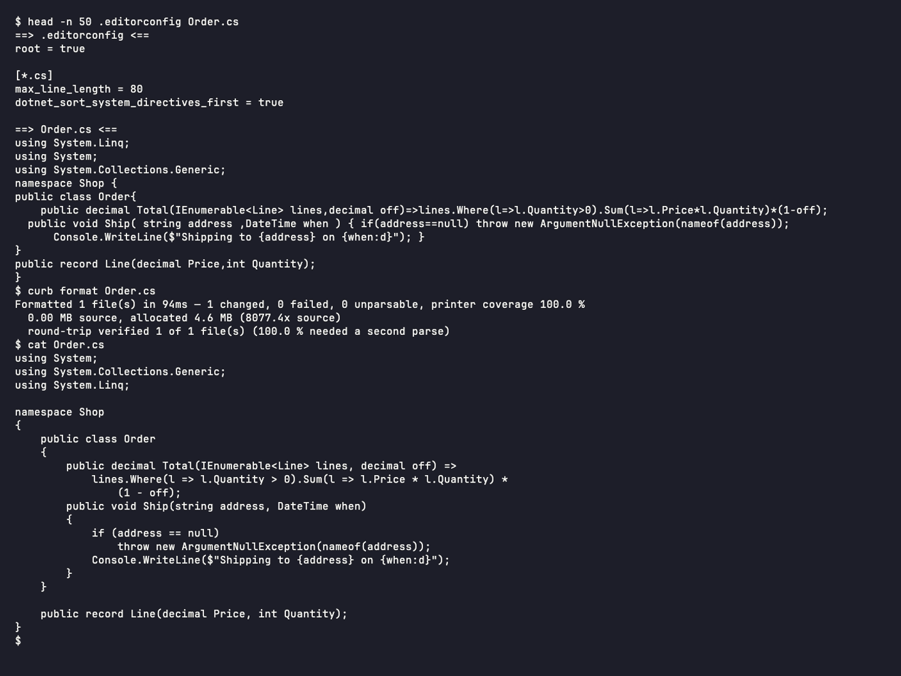

# curb-cli


A C# formatter that reads your `.editorconfig`, all of it, and reflows code to a line width the way Prettier does.
This is the `curb` command line tool.

[](https://www.nuget.org/packages/curb-cli)



## Install

```sh
dotnet tool install -g curb-cli
```

Ships as a native-AOT binary per platform (`linux-x64`, `linux-arm64`, `win-x64`, `win-arm64`, `osx-arm64`), with a
portable fallback. About 10 ms startup.

## Quick start

```sh
curb format ./src          # format in place
curb check ./src           # exit 1 if anything would change
curb print-config Foo.cs   # show every resolved option and its source
```

For code style rules that need a compilation (unused usings, `var`, naming), run a build first and let Curb read what
it reported:

```sh
dotnet build && curb cleanup
```

`curb rules` lists what Curb fixes and what it leaves to `dotnet format style`, and `curb options` lists the
`.editorconfig` keys it implements.

Curb honours the complete set of .NET formatting options
([IDE0055](https://learn.microsoft.com/dotnet/fundamentals/code-analysis/style-rules/ide0055)) with Roslyn's defaults,
so it agrees with Visual Studio and Rider out of the box; `max_line_length` opts into reflow on top. With Fantomas
in your tool manifest, `curb format` and `curb check` cover F# files too.

## Learn more

- Documentation: https://curb.nullean.net
- Format on every build instead: [curb](https://www.nuget.org/packages/curb), the MSBuild package
- Source and issues: https://github.com/nullean/curb
