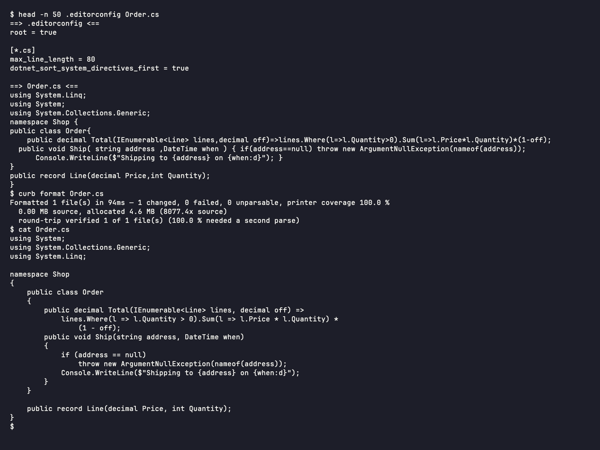

# curb


Curb for MSBuild: formats your C# from your `.editorconfig` before the compiler runs, on every `dotnet build`, so
`EnforceCodeStyleInBuild` only reports what a formatter cannot fix.

[](https://www.nuget.org/packages/curb)



## Install

```sh
dotnet add package curb
```

It is a development dependency, so it does not flow to the projects and packages that reference yours. By hand:

```xml
<PackageReference Include="curb" Version="*" PrivateAssets="all" />
```

## Quick start

Build as usual:

```sh
dotnet build                 # Debug: rewrites unformatted files before CoreCompile
dotnet build -c Release      # Release: checks only; an unformatted file fails the build with CURB0001
```

Curb reads the same `.editorconfig` keys Visual Studio, Rider and `dotnet format` do, all 39 of
[IDE0055](https://learn.microsoft.com/dotnet/fundamentals/code-analysis/style-rules/ide0055), with Roslyn's defaults.
Add `max_line_length` to opt into reflow:

```ini
[*.cs]
max_line_length = 120
```

On later builds the target skips unchanged projects entirely, and in a project with changes only the files that
changed are reformatted.

| Property | Default | What it does |
|---|---|---|
| `Curb_Check` | `true` in `Release`, else `false` | Check instead of rewriting. |
| `Curb_Bypass` | `false` | Skip Curb entirely. |
| `Curb_UnformattedAsWarnings` | `false` | Report CURB0001 as a warning instead of an error. |
| `Curb_Exe` | unset | Path to a native Curb binary, much faster to start than the bundled framework-dependent build. |
| `Curb_FSharp` | `true` | Format F# projects through the Fantomas their tool manifest pins. |

## Learn more

- Documentation: https://curb.nullean.net, and the full property list in
  [MSBuild integration](https://curb.nullean.net/workflow/msbuild/)
- The CLI for pre-commit hooks, CI and scripting: [curb-cli](https://www.nuget.org/packages/curb-cli)
- Source and issues: https://github.com/nullean/curb
